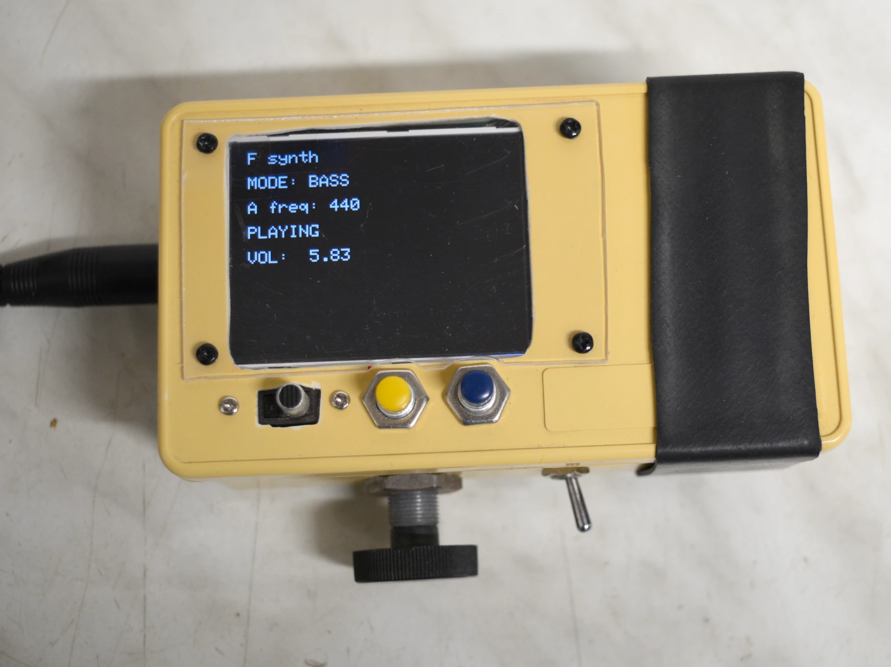
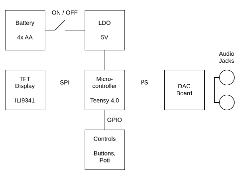

# Bass Synthesizer

This is a small synthesizer, capable of playing a single note (F1). This was built to replace a bowed upright bass holding out a long note.

## Features

* 3 different sounds: 
  * Sine wave
  * Sine wave + 3 overtones
  * Electric bass tone emulation
* Tunable from 439Hz to 445Hz "A" reference tone to match other instruments
* Volume control
* Two jacks for inline connection between bass and amp

## Technology

The core of this project is a Teensy 4.0 microcontroller, programmed with the Arduino IDE and Teensyduino.
This combination was chosen because it offers plenty of processing power for DSP applications as well as an extensive audio library with a graphical configuration interface,
allowing for fast implementation of the required features.

## Reliability

Used during many rehearsals and multiple concerts without issues.
